## {background-image="libs/vaqueiro.png"}

## {background-image="libs/homen_caatinga.jpg"}

## {background-image="libs/pesq_rest.png"}

## {background-image="libs/image-24.png"}

# ¿Qué tienen en común estas personas?

## Sistemas de conocimiento
:::{.columns}
:::{.column}
#### Científico Ecológico
- Métodos replicables
- Prueba de hipótesis
- Capacidad de abstracción
:::
:::{.column}
#### Tradicional ecológico
- Acumulación milenaria
- Empirismo vivo
- Intercambio entre culturas
:::
:::
:::{.fragment}
{width=70% fig-align=center}
:::

## ¿Qué estamos restaurando?
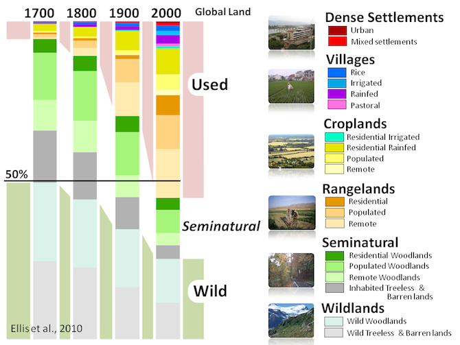{fig-align=center width=150%}

Fuente: Erle Ellis

## Errores históricos de la Conservación

[Melo et al (2014) Biotropica](https://doi.org/10.1111/btp.12114)

{.absolute top=70 right=10 width=30%}

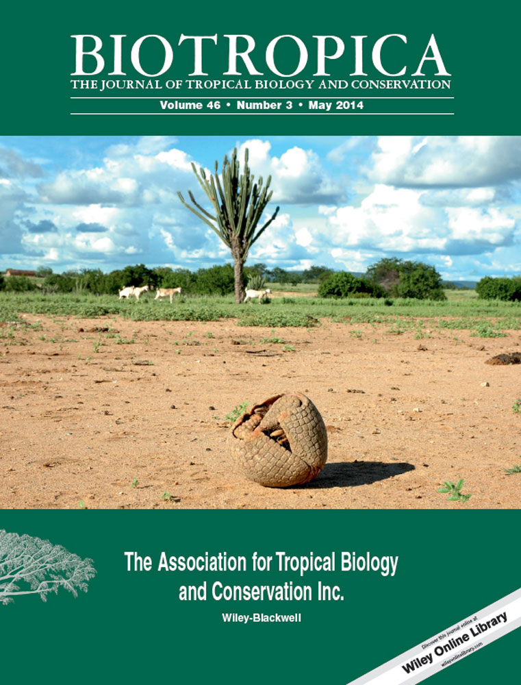{.absolute top=250 right=10 width=30%}

## La importancia de los PI&CL

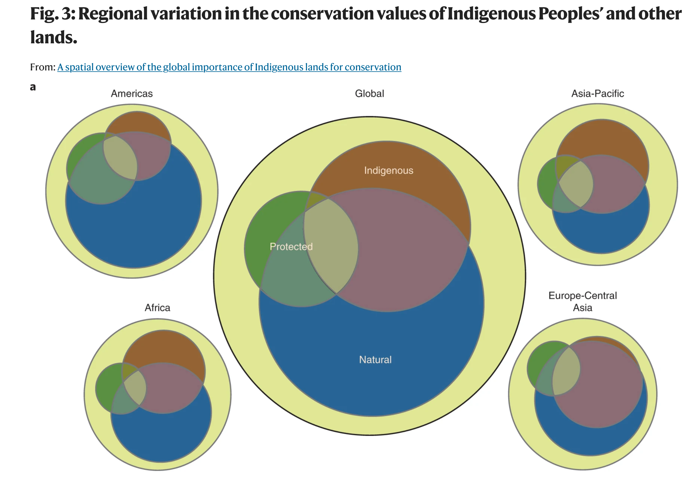{fig-align=center width=150%}

## {background-image="libs/pessoas.png" background-size="cover"}

## ¿Cuál es el papel de la restauración en este contexto?{.center}

## ¡La restauración avanza!

- Ofrecer métodos confiables :+1:
- Planificación sistemática :+1:
- Importancia geopolítica :+1:
- [Justicia Ambiental]{style="color:red"} :-1:
- [Transdisciplinariedad]{style="color:red"} :-1:

## Conocimientos Ecológicos Locales - CEL

::::{.columns}
:::{.column width="50%"}
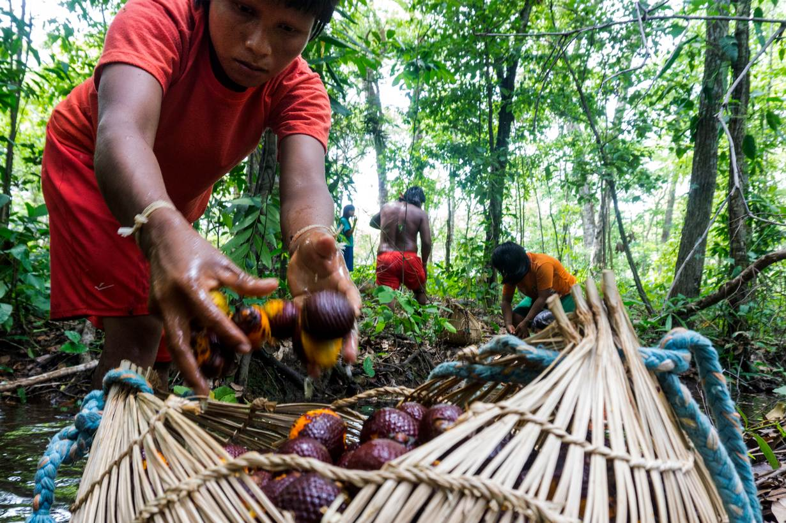{width=600}

:::
:::{.column width="50%"}
-   Frontera de conocimiento
-   Ayudan a descolonizar la ciencia
-   Necesitan ser reconocidos
-   Están amenazados
:::
::::

## La Caatinga como laboratorio vivo de Restauración Biocultural {.center}

## ¿Y si le preguntáramos a las personas?
:::{.nonincremental}
::::{.columns}
:::{.column width="50%"}
::: {style="font-size: 90%;"}
- Especies culturalmente importantes
- Múltiples beneficios (leña, medicinal, etc.)
- Relativamente abundantes
- Mantienen diversidad

[Sena et al (2022), Restoration Ecology](https://onlinelibrary.wiley.com/doi/abs/10.1111/rec.13599)
:::
:::
:::{.column width="50%"}

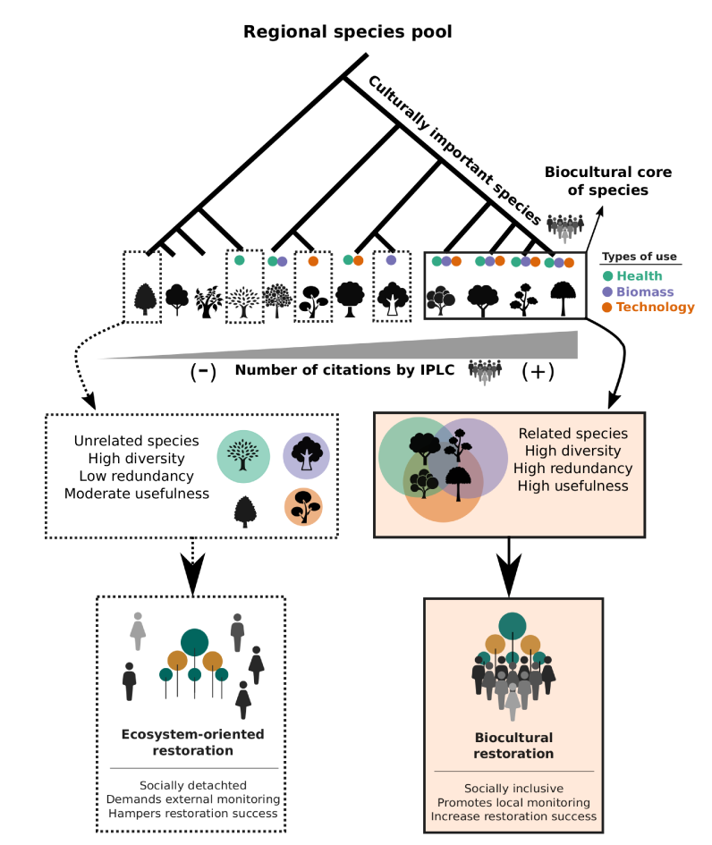{.absolute width="50%" top="55" right="00"}
:::
::::
:::

## 8% de las especies > 50% de los usos
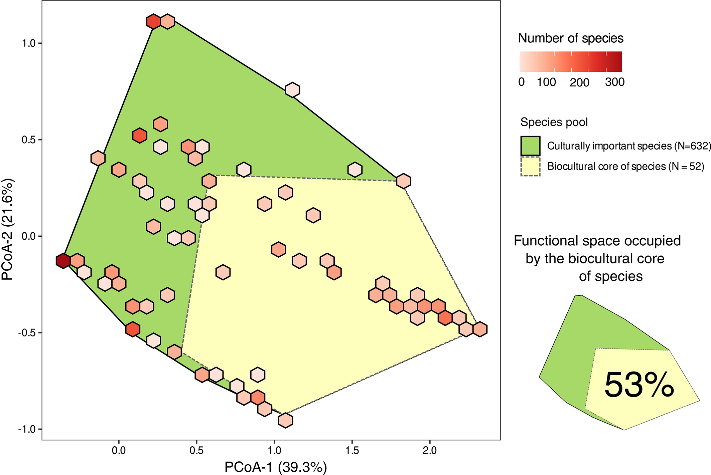{fig-align=center, width=85%}

[Sena et al (2022), Restoration Ecology](https://onlinelibrary.wiley.com/doi/abs/10.1111/rec.13599)

## 
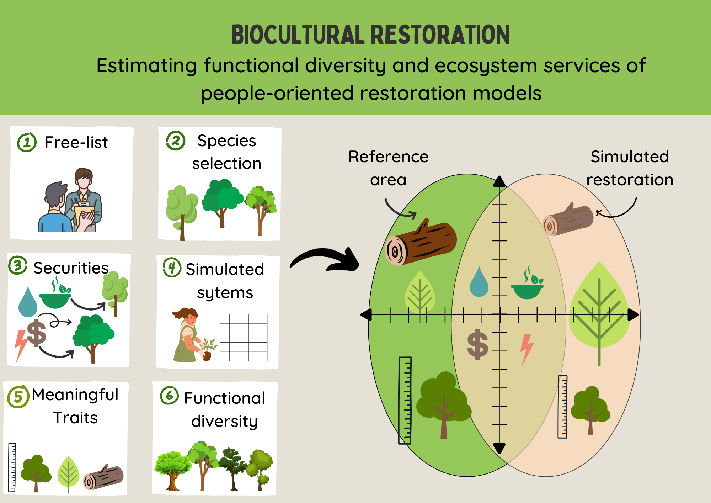{fig-align=center, width=95%}

[Silva et al (2025) Conservation Biology](https://doi.org/10.1111/cobi.70036)

##

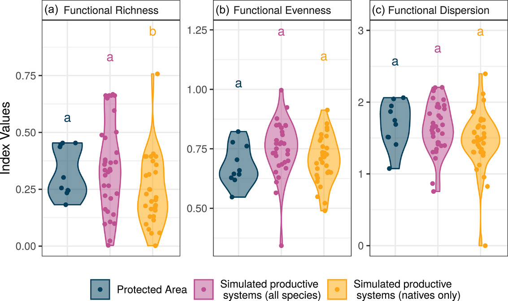{fig-align=center, width=95%}

## La restauración no puede ser apolítica
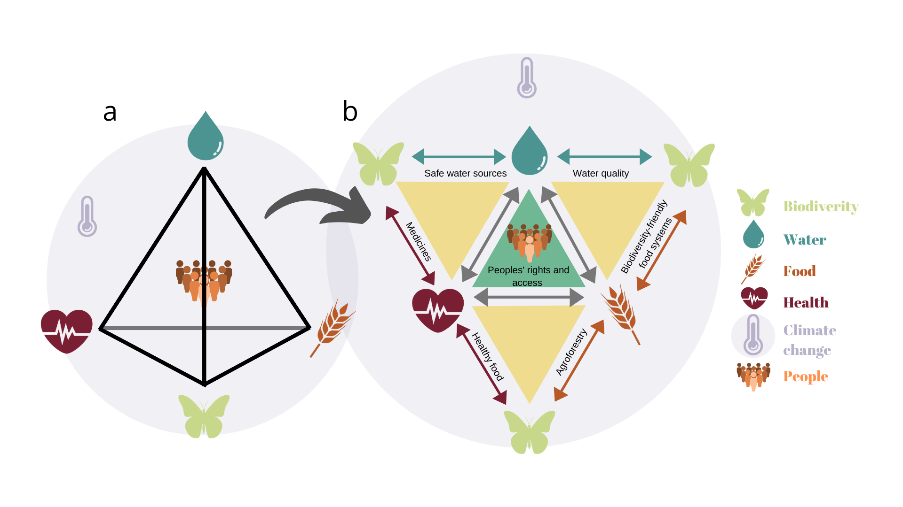{fig-align=center, width=105%}

[IPBES Nexus-Report 2025 & Melo et al 2021](https://www.nature.com/articles/s41893-020-00608-z)

## ¿Quién es dueño de la Caatinga?
:::{.nonincremental}
::::{.columns}
:::{.column width="50%"}

- ~ 1 millón de propiedades en 1204 municipios
  - 97.8% pequeñas
       - 17.9 Mha
       - 51% Vegetación Nativa
  - 2.2% Grandes propiedades
       - 15.2 Mha
       - 69% Vegetación Nativa
:::

:::{.column width="50%"}

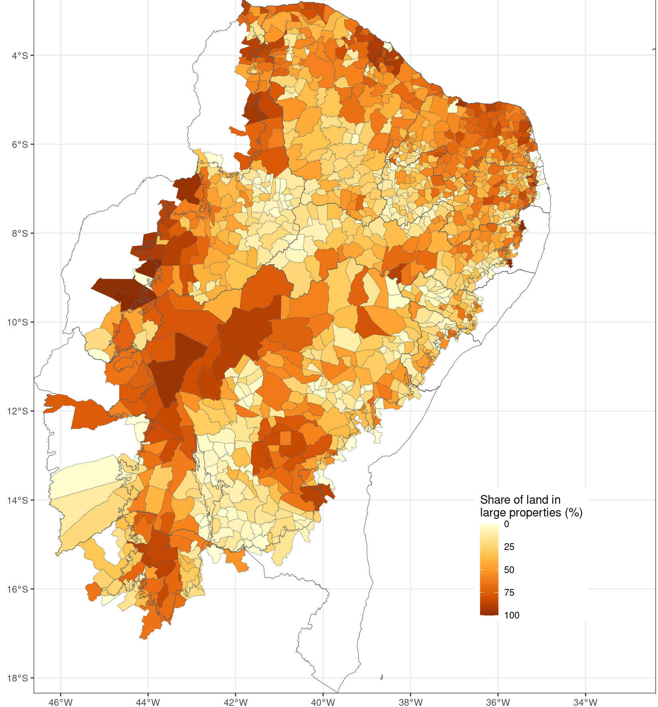

:::
::::
:::

## Estrategias diferenciadas
| Tipo de déficit | Estrategia de Restauración |
|-----|:-----|
| Grandes propiedades     | Restauración activa; adecuación legal; cadena de suministro   |
| Pequeñas propiedades   | Agroforestería; Restauración Biocultural  |
| Híbrido      | Combinaciones de medidas según el contexto     |

## Espacializando las estrategias
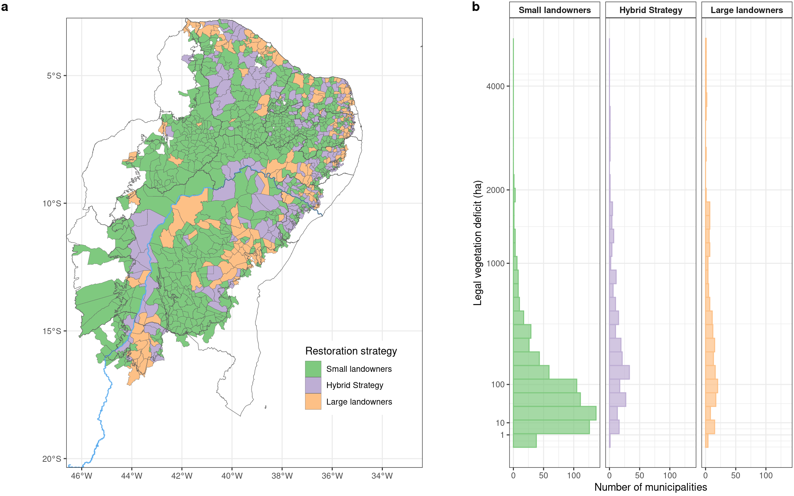{fig-align=center}

## Seguridad alimentaria y Caatinga
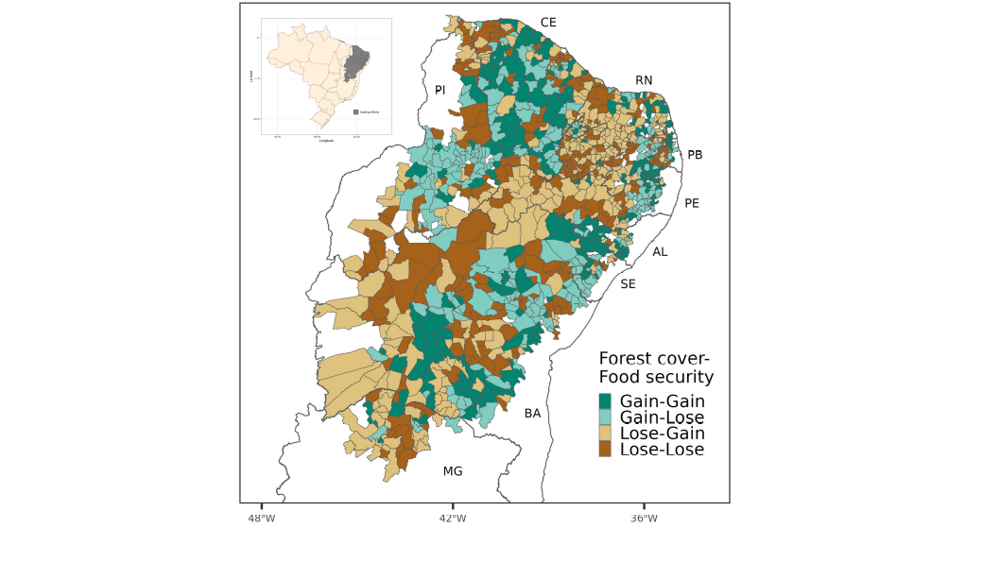{.absolute right=300}
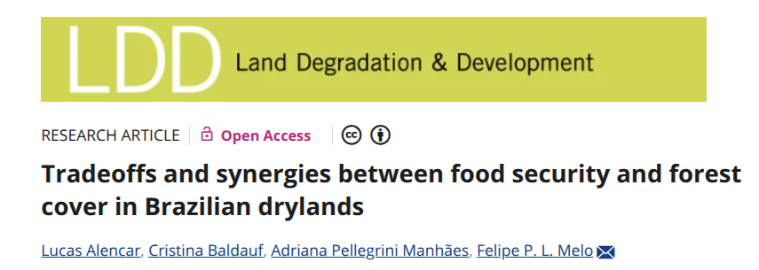{.absolute top=80 right=20 width=50%}

## Caatinga vs. Desarrollo

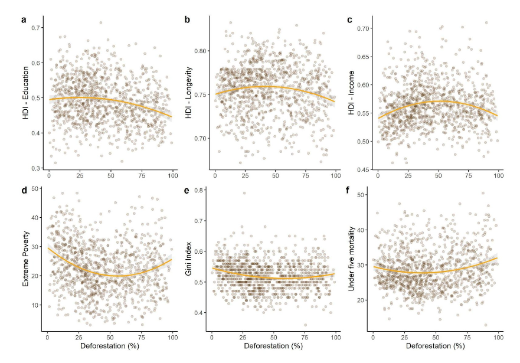{fig-align=center, width=120%}

Fuente: [Alencar et al 2025](https://www.sciencedirect.com/science/article/pii/S1389934125001509)

## Dinámica población-ambiente

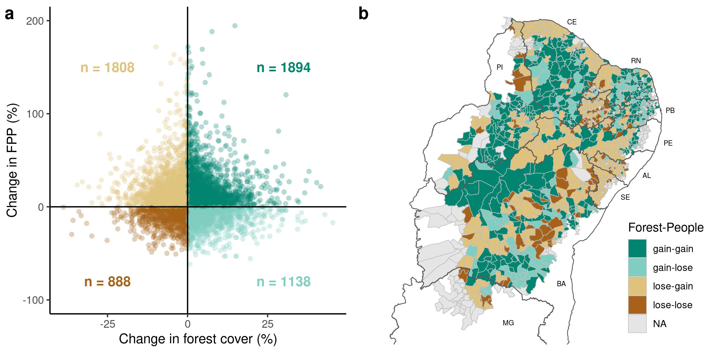{fig-align=center, width=120%, height=150%}

Fuente: Alencar et al en prenta PNAS

## La restauración está hecha de personas

::::{.columns}

:::{.column width="30%"}
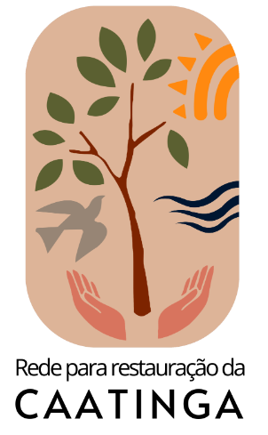

:::
:::{.column width="70%"}
- Gentes de la Caatinga (colectivos)
- Saberes de la Caatinga (ciencia)
- Ojos de la Caatinga (monitoreo)
- Aguas de la Caatinga (seguridad hídrica)

:::

::::

## Ejemplos de todo el mundo
{fig-align=center}

## Fundamentos

## En construcción

:::{.columns}
:::{.column}

:::
:::{.column}

:::
:::

## Principales lecciones
:::{.nonincremental}
::::{.columns}
:::{.column width="50%"}
- Incluir capas de información social
- Considerar las diferentes desigualdades
- No reproducir injusticias
- Priorizar las oportunidades localmente
:::

:::{.column width="50%"}

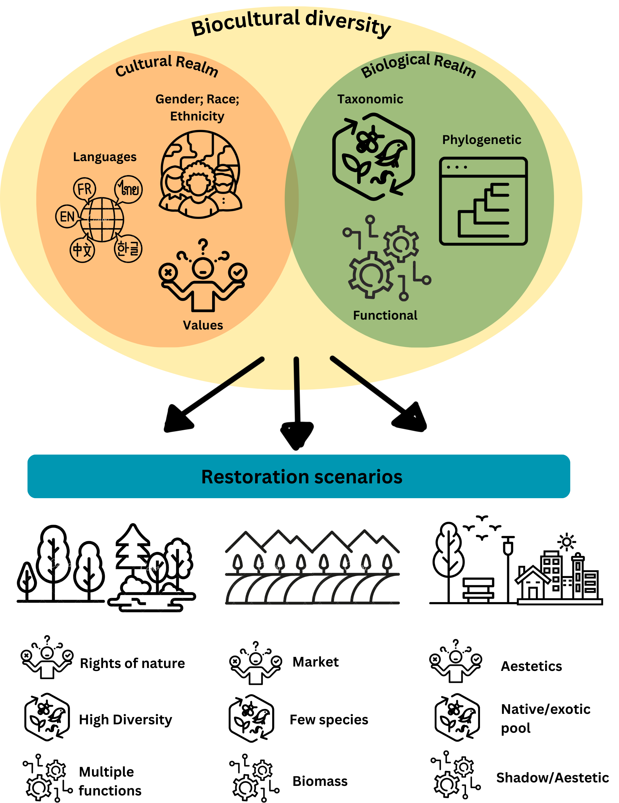{.absolute width=50% top=20 right=-50}

:::
::::
:::

# Gracias

felipe.plmelo@ufpe.br

{fig-align=center width=35%}

